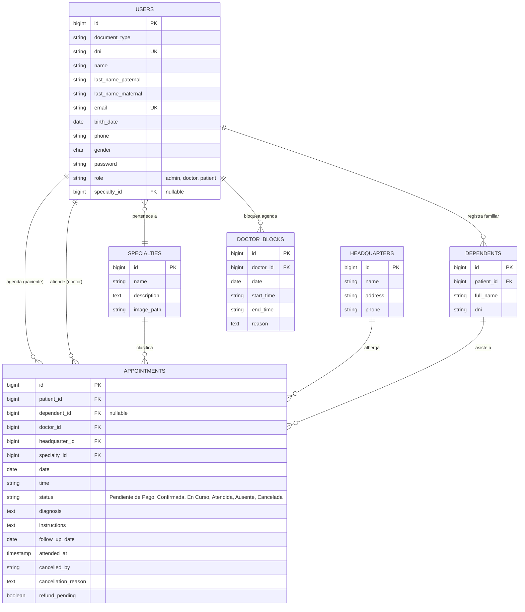

# Manual de Ingeniería, Estandarización y Flujo de Trabajo

## 1. Reglas de Interfaz Gráfica (UI/UX) - (Para Fernando)
La identidad visual de *Healthy Life Medical Clinic* es estricta. Queda absolutamente prohibido el uso de degradados o paletas ajenas a las establecidas (específicamente, prohibido el uso del color naranja).

- **Color Base Global (Fondos):** Verde agua claro `#F4F9F8`.
- **Color Primario (Textos/Cabeceras/Modales):** Azul marino `#22396b`.
- **Color de Acento (Bordes/Botones principales):** Turquesa `#4DB6AC`.
- **Tarjetas y Contenedores:** Fondo blanco puro, con sombra suave (`shadow-md`), bordes redondeados (`rounded-xl`) y borde superior/izquierdo en color turquesa o azul marino para destacar jerarquía.

## 2. Nomenclatura Estricta del Código
- **Base de Datos:** Tablas en inglés, minúsculas y plural (`users`, `appointments`, `specialties`, `headquarters`, `dependents`, `doctor_blocks`).
- **Modelos:** PascalCase singular (`User`, `Appointment`).
- **Controladores:** PascalCase con sufijo correspondiente (`DoctorAppointmentController`, `PatientConsultationController`).
- **Vistas (Blade):** Organizadas en subcarpetas lógicas (`doctor/blocks/index.blade.php`, `patient/appointments/show.blade.php`).

## 3. Arquitectura de Base de Datos (Modelo ER)
A continuación se documenta el Diagrama Entidad-Relación actualizado (soportado por Mermaid.js) que rige el sistema:

