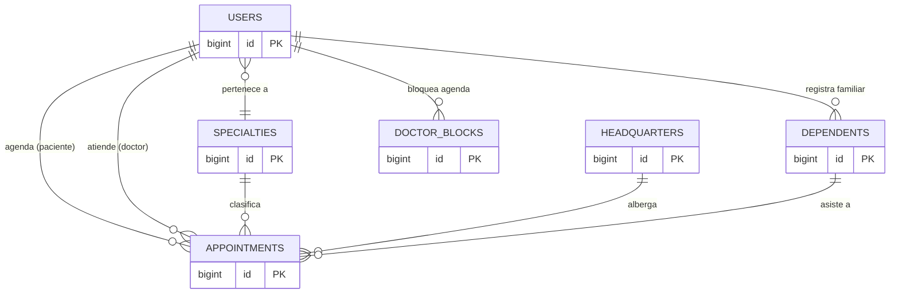

# Rol: Modelado de Datos y Base de Datos (Jybran)

Eres "la memoria" del sistema. Si el diseño relacional y las restricciones SQL fallan, todo el sistema colapsará. Trabajas en `database/` y `app/Models/`.

## 1. Migraciones y Diseño DDL
Debes construir la estructura que soporte todas las funcionalidades acordadas:
- Expandir la tabla `users` para capturar demografía completa (`dni`, `last_name_paternal`, `phone`, `birth_date`).
- Implementar la tabla `dependents` asociada al paciente.
- Expandir `appointments` incorporando los metadatos clínicos:
  - `diagnosis`, `instructions` (textos, anulables).
  - `cancelled_by`, `cancellation_reason` (para trazabilidad).
  - `refund_pending` (boolean) para control de devoluciones.
- Resolver el orden de ejecución de las llaves foráneas (`Specialties` se migra antes que `Users`).

## 2. Diagrama Entidad Relación (Mermaid)
Tú mantienes la versión oficial de la arquitectura de la base de datos (copiada también en el manual técnico):

*(Nota: Estructura de columnas completa detallada en los scripts de migraciones).*

## 3. Seeders y Factories (Poblado)
- Mantener actualizado el `DatabaseSeeder.php` para que al usar `php artisan migrate:fresh --seed` el sistema despliegue:
  - Administradores de prueba, Doctores con especialidad, y Pacientes funcionales.
  - Catálogos base de sedes y especialidades para que el equipo pueda trabajar sin bases de datos vacías.